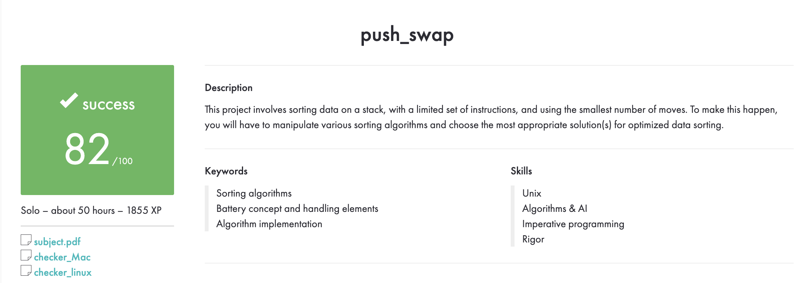

# 🔄 push_swap

> **An integer-sorting project in C using two stacks and a limited set of operations, developed as part of the 42 School curriculum.**

## 🎯 About the project

`push_swap` takes a list of unique integers and prints a sequence of stack operations that sorts them in ascending order. It uses two stacks, `A` and `B`, and aims to produce an efficient instruction sequence. The companion `checker` program can apply the operations and verify the result.

The project explores stack data structures, algorithm design, input validation, operation-cost reasoning, and performance measurement.

## 🧠 Sorting approach

- Small inputs are handled with dedicated sorting steps.
- For larger inputs, values are distributed between stacks `A` and `B`.
- Before moving values back, the program evaluates rotation costs and combines compatible rotations where possible.
- The final rotation places the smallest value at the top of stack `A`.

## 🕹️ Available operations

| Operation | Description |
|---|---|
| `sa`, `sb`, `ss` | Swap the top elements of one or both stacks |
| `pa`, `pb` | Push the top element from one stack to the other |
| `ra`, `rb`, `rr` | Rotate one or both stacks upward |
| `rra`, `rrb`, `rrr` | Rotate one or both stacks downward |

## 📁 Project structure

| Path | Purpose |
|---|---|
| `sources/` | Input validation, stack operations, and sorting logic |
| `includes/push_swap.h` | Data structures and function declarations |
| `libraries/libft/` | Helper C functions used by the project |
| `Makefile` | Builds `push_swap` and `checker` |
| `lfrasson_tester.sh` | Optional correctness and operation-count checks |
| `benchmark_vbrazanik.sh` | Optional randomized performance measurements |

## 🛠️ Requirements

- A C compiler such as `gcc` or `cc`
- `make`
- A UNIX-like environment (Linux or macOS)

## 🚀 Build

```bash
git clone <repository-url>
cd push_swap
make
```

This creates the `push_swap` and `checker` executables.

## ▶️ Usage

Generate operations to sort a list:

```bash
./push_swap 3 2 1 4
```

You can also pass the numbers as one quoted argument:

```bash
./push_swap "3 2 1 4"
```

Verify the result with `checker`:

```bash
ARG="3 2 1 4"
./push_swap $ARG | ./checker $ARG
```

A correctly sorted result prints `OK`. Count the generated operations with:

```bash
./push_swap 3 2 1 4 | wc -l
```

Invalid input, duplicate values, and integers outside the `int` range should be rejected.

## 🧹 Makefile commands

| Command | Description |
|---|---|
| `make` | Build `push_swap` and `checker` |
| `make clean` | Remove object files |
| `make fclean` | Remove object files, executables, and the libft archive |
| `make re` | Clean and rebuild |
| `make norm` | Check the main project files with Norminette if installed |

## 🧠 Skills practiced

- Stack operations and moving data between stacks
- Parsing input and handling duplicates and boundary values
- Reasoning about rotation costs and operation-count optimization
- Modular C development and Makefiles
- Verifying correctness and measuring performance

## 🏅 42 evaluation

The project received a **successful score of 82/100**. The evaluation summary is included below.



## 👩‍💻 Author

**Sedef Akkaya**  
[GitHub](https://github.com/sakkayaa) · [LinkedIn](https://www.linkedin.com/in/sedef-akkaya-0a5580228/)

---

✨ *Sort with fewer moves. Make every stack operation count.*
